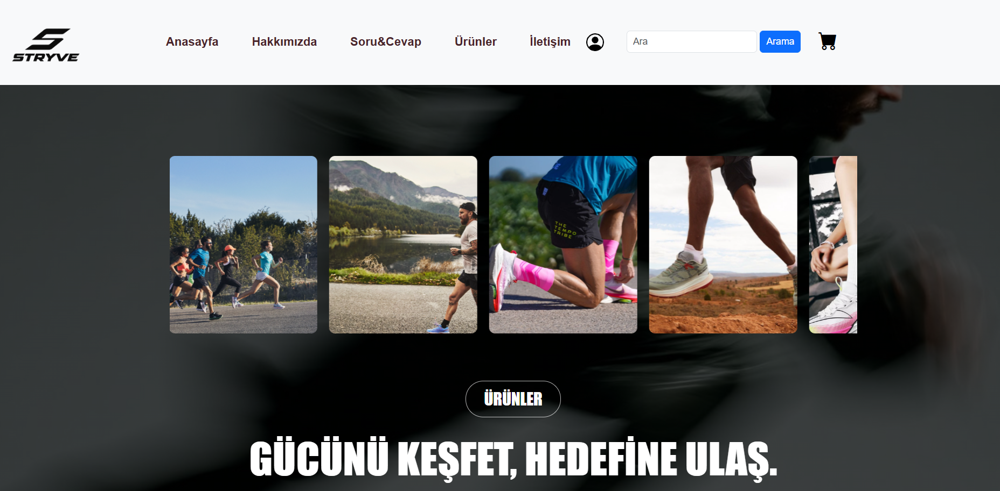
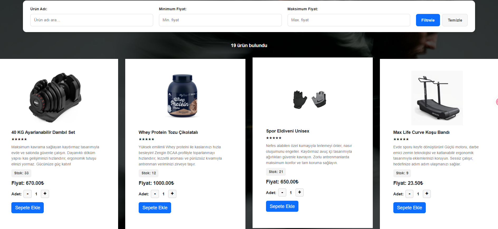
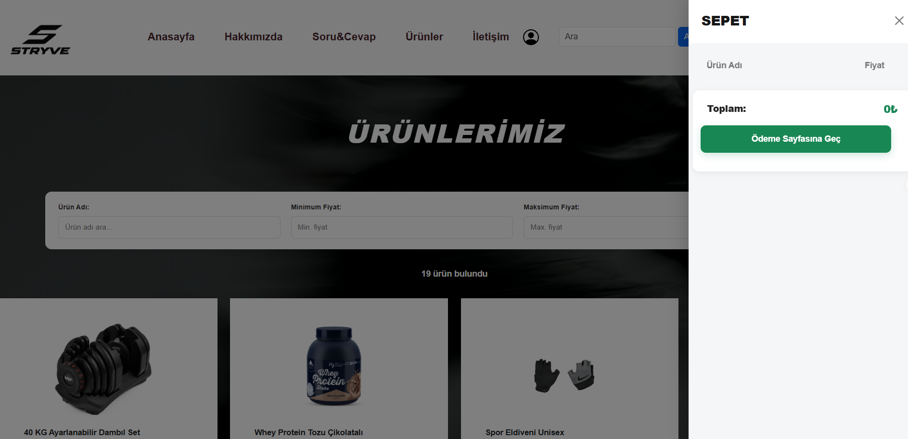
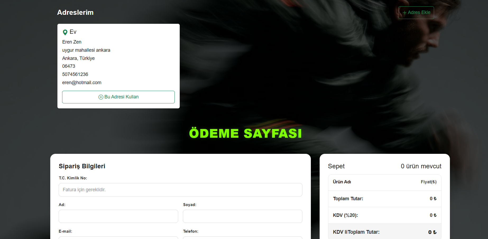
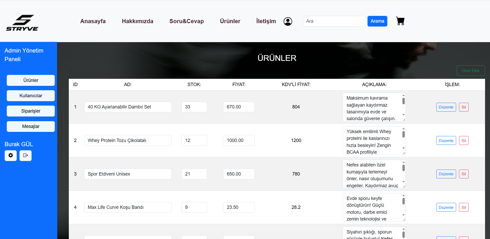
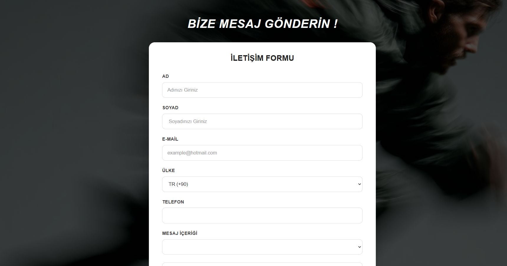

# STRYVE | Spor ve Fitness E-Ticaret Platformu

STRYVE, spor ve fitness ürünlerinin çevrim içi ortamda sergilenmesi ve satış süreçlerinin yönetilmesi amacıyla geliştirilmiş, frontend ve backend katmanlarına sahip bir e-ticaret web projesidir.

Proje; kullanıcıların ürünleri inceleyebildiği, ürünleri sepete ekleyebildiği, sipariş oluşturabildiği ve adreslerini yönetebildiği bir alışveriş deneyimi sunarken yöneticilere de ürün, kullanıcı ve sipariş yönetimi için ayrı bir yönetim paneli sağlar.

**STRYVE**, Vue 3, Vite, Bootstrap, Node.js, Express.js ve MySQL teknolojileri kullanılarak geliştirilmiştir.

## Proje Hakkında

STRYVE projesi, modern bir spor alışveriş platformunun temel ihtiyaçlarını karşılayacak şekilde tasarlanmıştır. Kullanıcı arayüzü, sunucu tarafındaki işlemler ve veritabanı bağlantıları bir araya getirilerek uçtan uca bir web uygulaması oluşturulmuştur.

Proje kapsamında kullanıcı işlemleri, ürün listeleme, filtreleme, sepet yönetimi, sipariş süreçleri, adres kayıtları ve rol bazlı yönetim ekranları üzerinde çalışılmıştır.

## Proje Özellikleri

- **Ana Sayfa:** STRYVE markasını tanıtan ve kullanıcıları ürünlere yönlendiren ana sayfa tasarımı.
- **Hakkımızda:** Proje ve marka hakkında bilgi sunan sayfa.
- **Soru ve Cevap:** Kullanıcıların sık sorulan sorulara ulaşabileceği bilgilendirme sayfası.
- **Ürünler:** Spor ve fitness ürünlerinin listelenmesi, ürün adına göre filtrelenmesi ve fiyat aralığına göre sıralanması.
- **Ürün Yönetimi:** Yönetici paneli üzerinden ürünlerle ilgili işlemlerin gerçekleştirilmesi.
- **Sepet Yönetimi:** Seçilen ürünlerin sepete eklenmesi ve sipariş öncesinde incelenmesi.
- **Sipariş ve Ödeme Süreci:** Teslimat bilgilerinin girilmesi, sipariş tutarının hesaplanması ve sipariş oluşturulması.
- **Adres Yönetimi:** Kullanıcıların teslimat adreslerini kaydedebilmesi ve yönetebilmesi.
- **Kullanıcı Yönetim Paneli:** Kullanıcıların kendileriyle ilişkili siparişlere ve hesap işlemlerine erişebilmesi.
- **Admin Yönetim Paneli:** Ürün, kullanıcı, sipariş ve müşteri mesajlarının yönetilebilmesi.
- **Kimlik Doğrulama ve Yetkilendirme:** Kullanıcı oturumlarının ve rol bazlı erişimlerin yönetilmesi.
- **Veritabanı Entegrasyonu:** Uygulama verilerinin MySQL veritabanında saklanması ve gerekli işlemlerde kullanılması.
- **Duyarlı Tasarım:** Farklı ekran boyutlarına uyum sağlayan kullanıcı arayüzleri geliştirilmesi.

## Kullanılan Teknolojiler

### Frontend
- Vue 3
- Vite
- JavaScript
- HTML5
- CSS3
- Bootstrap
- Bootstrap Icons

### Backend
- Node.js
- Express.js
- REST API

### Veritabanı
- MySQL
- phpMyAdmin

### Diğer Araçlar
- Git ve GitHub
- JSON Web Token (JWT)

## Proje Mimarisi

Proje üç temel katmandan oluşmaktadır:

- **Frontend:** Kullanıcı arayüzünü, sayfaları, ürün listeleme işlemlerini ve alışveriş deneyimini yönetir.
- **Backend:** İstemciden gelen API isteklerini işler, uygulama mantığını yürütür ve veritabanı işlemlerini gerçekleştirir.
- **Veritabanı:** Kullanıcılar, ürünler ve siparişler gibi uygulamaya ait verilerin saklanmasını ve yönetilmesini sağlar.

## Projenin Amacı

Bu proje, full stack web geliştirme alanında pratik deneyim kazanmak amacıyla geliştirilmiştir. Frontend ve backend arasındaki iletişim, REST API kullanımı, ilişkisel veritabanı işlemleri, kullanıcı yönetimi, kimlik doğrulama, yetkilendirme ve duyarlı arayüz tasarımı gibi konularda uygulamalı çalışma yapılmıştır.


## 🚀 Kurulum ve Çalıştırma

STRYVE projesini yerel bilgisayarınızda çalıştırmak için aşağıdaki adımları takip edebilirsiniz.

### 1. Gereksinimler

- Node.js ve npm
- MySQL
- phpMyAdmin
- Git

### 2. Projeyi İndirme

```bash
git clone REPO_ADRESINIZ
cd STRYVE
```

### 3. Backend Kurulumu

Backend klasörüne girerek gerekli paketleri yükleyin:

```bash
cd backend
npm install
```

Gerekli ortam değişkenlerini `.env` dosyasında yapılandırın. Veritabanı bağlantısı ve JWT için gereken değerleri kendi ortamınıza göre ayarlayın.

Backend sunucusunu başlatın:

```bash
node sql-db/server.js
```

### 4. Frontend Kurulumu

Yeni bir terminal açarak frontend klasörüne girin:

```bash
cd frontend
npm install
npm run dev
```

Terminalde gösterilen yerel adresi tarayıcıda açın.

### 5. Veritabanı Yapılandırması

MySQL sunucusunu başlatın ve phpMyAdmin üzerinden proje veritabanını oluşturun. Projede sağlanan SQL dosyası varsa içe aktarın. Backend veritabanı bağlantı ayarlarının doğru olduğundan emin olun.

### 6. Uygulamayı Çalıştırma

Uygulamayı kullanabilmek için frontend ve backend sunucularının çalışıyor olması ve MySQL bağlantısının doğru yapılandırılması gerekir.

## 📸 Proje Ekran Görüntüleri

### 🏠 Ana Sayfa

STRYVE'nin marka kimliğini yansıtan, kullanıcıları ürünlere yönlendiren ana sayfa tasarımı.



---

### 🛍️ Ürünler Sayfası

Spor ve fitness ürünlerinin listelendiği, ürün filtreleme ve fiyat sıralama işlemlerinin gerçekleştirilebildiği sayfa.



---

### 🛒 Sepet Sayfası

Kullanıcıların sepete ekledikleri ürünleri ve sipariş öncesindeki sepet bilgilerini görüntüleyebildiği sayfa.



---

### 💳 Sipariş ve Ödeme Sayfası

Teslimat bilgilerinin girildiği ve sipariş işlemlerinin gerçekleştirildiği ödeme ekranı.



---

### 🛠️ Admin Yönetim Paneli

Ürün, kullanıcı, sipariş ve müşteri mesajları gibi yönetim işlemlerinin gerçekleştirildiği yönetim paneli.



---

### 📩 İletişim Sayfası

Kullanıcıların iletişim kurabilmesi için hazırlanan iletişim sayfası.


